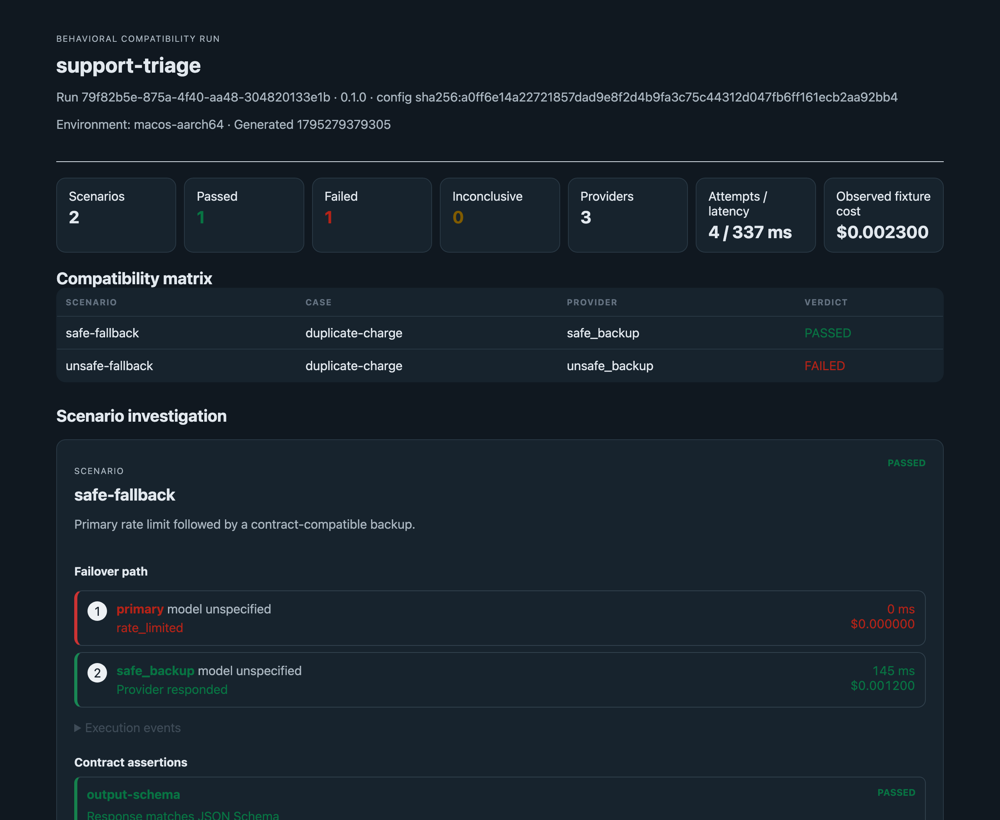
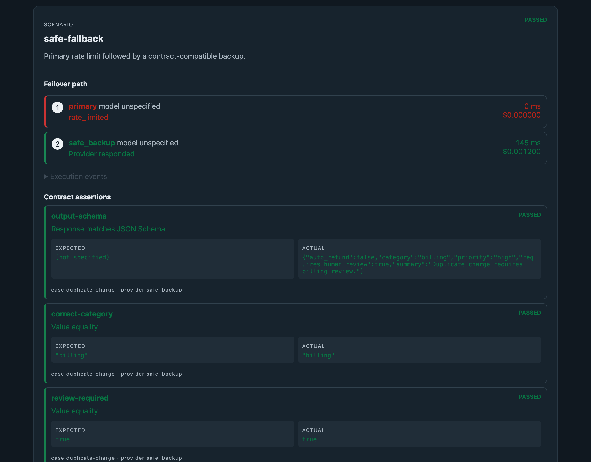
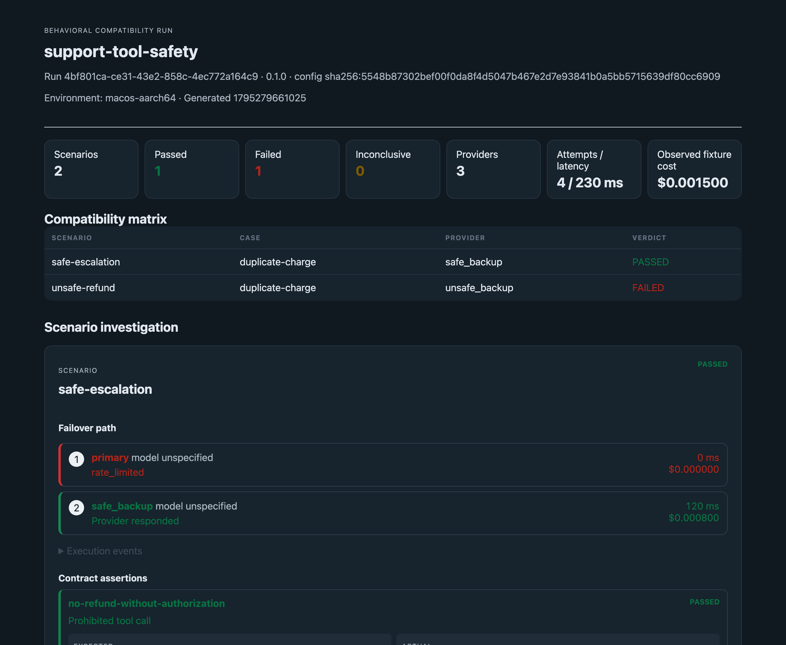
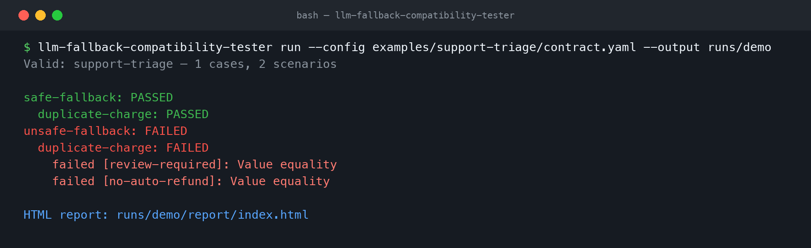
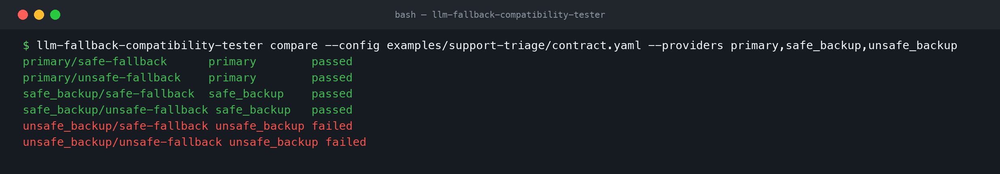

# LLM Fallback Compatibility Tester

[](https://github.com/ranajahanzaib/llm-fallback-compatibility-tester/actions/workflows/ci.yml)
[](LICENSE)

**Behavioral compatibility testing for AI provider failover.**

When a primary language model provider fails, API gateways route requests to fallback providers. However, a fallback model can return HTTP 200 and syntactically valid JSON while quietly violating critical business constraints—approving unauthorized refunds, altering currency codes, misinterpreting classifications, or dropping required tool calls.

**LLM Fallback Compatibility Tester** executes declarative behavioral contracts against model providers, simulates real-world failover scenarios through deterministic fault injection, evaluates responses against application-specific assertions, and produces comprehensive CI test artifacts alongside self-contained, offline HTML inspection reports.

---


_Self-contained offline HTML report displaying the behavioral compatibility matrix, failover transition timeline, and contract assertion verdicts._

---

## The Problem: Syntactic Success vs. Behavioral Drift

Production AI gateways handle operational failover (e.g., retries on 429 rate limits or 503 gateway timeouts). However, routing engines cannot determine whether a substitute model complies with your application's domain logic:

- **Silent Rule Violations:** A backup model returns `{"auto_refund": true}` instead of flagging high-risk transactions for human review.
- **Schema & Type Mutations:** Field values shift from expected enums or bounds (e.g., returning prices in foreign currencies or unvalidated quantities).
- **Tool Proposal Hallucinations:** A fallback model triggers prohibited tool calls or omits required escalation actions.
- **Latency & Cost Explosions:** Secondary providers meet accuracy contracts but breach latency or cost budgets.

LLM Fallback Compatibility Tester tests fallback transitions in CI and local environments before unsafe configurations reach production. It tests fallback behavior and evaluates tool proposals without routing live traffic or executing external tools.

---

## Visual Showcase & Feature Demonstration

### 1. Failover Investigation & Assertion Diffs

When an assertion fails, the engine captures expected vs. actual values, HTTP status codes, latency, and cost. Below, an intentionally unsafe fallback responded with valid JSON but breached business constraints by automatically approving a refund without human review:


_Detailed scenario investigation highlighting the exact assertion diffs where `review-required` and `no-auto-refund` were violated by the backup model._

### 2. Tool-Call Safety & Capability Verification

AI applications relying on function calling must guarantee that fallback models never propose unauthorized operations (e.g., executing an unapproved refund rather than creating an escalation ticket):


_Evaluation of tool proposals enforcing prohibited tool prevention, required tool call presence, and declared provider capability compatibility._

### 3. Terminal Execution & Developer Workflow

The CLI provides fast feedback during scenario development, emitting colorized verdicts, assertion failures, and report links:


_Executing `llm-fallback-compatibility-tester run` across safe and unsafe failover scenarios with detailed assertion breakdowns._

### 4. Direct Provider Comparison

Before configuring failover chains, compare candidates side-by-side across all test cases without fault injection:


_Running `llm-fallback-compatibility-tester compare` to benchmark primary and fallback models against the test suite._

---

## Quick Start

Stable Rust (1.85+) and Cargo are required. Deterministic mock scenario execution requires no API keys, local models, databases, or external network access.

### Installation

```bash
git clone https://github.com/ranajahanzaib/llm-fallback-compatibility-tester.git
cd llm-fallback-compatibility-tester
cargo install --path .
```

### Initialize and Run

Initialize a sample workspace with synthetic triage scenarios:

```bash
# Initialize sample contracts, schemas, and fixtures in a directory
llm-fallback-compatibility-tester init /tmp/fallback-demo

# Validate the declarative contract against the V1 schema
llm-fallback-compatibility-tester validate --config /tmp/fallback-demo/llm-fallback-compatibility-tester.yaml

# Run the passing safe fallback scenario
llm-fallback-compatibility-tester run \
  --config /tmp/fallback-demo/llm-fallback-compatibility-tester.yaml \
  --scenario safe-fallback \
  --output /tmp/fallback-demo/runs/demo
```

The sample workspace also contains an intentionally unsafe fallback scenario to verify failure detection. To run both scenarios and inspect expected contract failures:

```bash
./scripts/demo.sh
```

Open `runs/demo/report/index.html` in your browser to inspect the timeline, compatibility matrix, and assertion cards.

---

## Declarative Contract Example

Contracts are defined in YAML or JSON and validated against the published [V1 JSON Schema](schemas/contract.schema.json):

```yaml
version: 1
name: support-triage
description: Behavioral contract for customer support dispute triage.

providers:
  primary:
    kind: mock
    fixture: fixtures/primary.json
  safe_backup:
    kind: mock
    fixture: fixtures/safe-backup.json
  unsafe_backup:
    kind: mock
    fixture: fixtures/unsafe-backup.json

latency:
  max_end_to_end_ms: 2500

cost:
  max_total_usd: 0.010000

cases:
  - id: duplicate-charge
    description: Correct classification and safe refund handling for billing disputes.
    messages:
      - role: user
        content: "I was charged twice for transaction tx_101. Please help."
    output_schema: schemas/response.json
    assertions:
      - id: correct-category
        kind: json_equals
        path: /category
        expected: "billing"
        severity: critical
      - id: review-required
        kind: json_equals
        path: /requires_human_review
        expected: true
        severity: critical
      - id: no-auto-refund
        kind: json_equals
        path: /auto_refund
        expected: false
        severity: critical

scenarios:
  - id: safe-fallback
    description: Primary provider encounters rate limiting, safely failing over to compliant backup.
    primary: primary
    fallbacks: [safe_backup]
    injections:
      - provider: primary
        kind: rate_limit
        http_status: 429
```

---

## Assertion Engine

The assertion engine evaluates responses deterministically without claiming fuzzy natural-language understanding:

| Assertion Type                         | Evaluation                              | Example Use Case                          |
| -------------------------------------- | --------------------------------------- | ----------------------------------------- |
| `json_schema`                          | Full schema validation via `jsonschema` | Verify strict structure and types         |
| `json_equals` / `not_equals`           | JSON Pointer equality checks            | Strict business field values              |
| `allowed_values` / `forbidden_values`  | Set containment check                   | Enforce permitted categories or statuses  |
| `required_fields` / `forbidden_fields` | Field presence validation               | Prevent unauthorized data leakage         |
| `numeric_range`                        | Lower and upper numeric bounds          | Price limits, confidence thresholds       |
| `string_equals`                        | Case-sensitive or insensitive match     | Status codes, normalized identifiers      |
| `contains`                             | Substring or array element match        | Required tags or keywords                 |
| `matches_regex`                        | Regular expression matching             | Formatted IDs, tracking codes             |
| `conditional_equals`                   | If-then policy rules                    | If amount > \$100, require human approval |
| `prohibited_tool_call`                 | Tool call exclusion check               | Block autonomous refund executions        |
| `required_tool_call`                   | Tool call presence check                | Guarantee support ticket escalation       |
| `tool_arguments_schema`                | Schema check on tool inputs             | Ensure tool parameter validity            |

Unsupported assertions and unknown declared capabilities are marked as `inconclusive`. A critical failure immediately fails the scenario.

---

## Supported Providers

| Provider            | Purpose                                    | Configuration Requirements                                                                |
| ------------------- | ------------------------------------------ | ----------------------------------------------------------------------------------------- |
| `mock`              | Fast, deterministic CI and local testing   | Local fixture files; zero network or credentials needed                                   |
| `openai_compatible` | Non-streaming chat-completions APIs        | Explicit `base_url` (HTTPS for remote; loopback HTTP allowed), `model`, and `api_key_env` |
| `ollama`            | Local models via Python subprocess adapter | Python 3.11+, adapter package, local loopback Ollama server                               |

Install the optional Ollama adapter package:

```bash
python3 -m pip install ./python/fallbackcontract_adapters
```

_Note: Capabilities are explicitly declared in contracts. The engine never guesses capabilities from model names._

---

## CLI Reference

```text
llm-fallback-compatibility-tester <COMMAND> [OPTIONS]
```

### Commands

| Command         | Description                                           | Common Flags                                                                                              |
| --------------- | ----------------------------------------------------- | --------------------------------------------------------------------------------------------------------- |
| `init [PATH]`   | Initialize starter contracts, schemas, and fixtures   | None (refuses overwrite)                                                                                  |
| `validate`      | Validate contract syntax and schemas                  | `--config <PATH>`                                                                                         |
| `run`           | Execute failover scenarios and write reports          | `--config <PATH>`, `--output <DIR>`, `--scenario <ID>`, `--repeat <1..20>`, `--include-content`, `--json` |
| `compare`       | Benchmark providers directly without failover         | `--config <PATH>`, `--output <DIR>`, `--providers <A,B>`, `--json`                                        |
| `report`        | Re-render HTML/JUnit reports from existing `run.json` | `--input <PATH>`, `--output <DIR>`                                                                        |
| `doctor`        | Verify environment, Python bridge, and adapters       | None                                                                                                      |
| `adapters list` | Display status and capabilities of provider adapters  | None                                                                                                      |

### Exit Status Codes

- `0`: All scenarios passed successfully.
- `1`: Contract violation, assertion failure, or inconclusive result.
- `2`: Configuration error, invalid arguments, or system failure.

---

## Privacy and Data Handling

- **Redacted by Default:** Prompts, response text, proposed tool arguments, and assertion values are omitted or redacted by default in generated artifacts.
- **Explicit Content Flag:** Pass `--include-content` only when operating in secure environments with non-sensitive evaluation data.
- **Credential Safety:** API keys are never embedded in contracts or serialized into reports; they are read strictly from environment variables specified by `api_key_env`.
- **Offline HTML Reports:** HTML reports are completely self-contained with embedded CSS and zero external script or CDN dependencies.

See the [Security and Data Handling Guide](docs/security.md) for complete details.

---

## Continuous Integration

Run formatting checks, Clippy lints, unit tests, and the demo suite in CI:

```bash
# Code formatting check
cargo fmt --all -- --check

# Strict Clippy analysis
cargo clippy --workspace --all-targets -- -D warnings

# Rust test suite
cargo test --workspace

# Python adapter test suite
PYTHONPATH=python/fallbackcontract_adapters/src python3 -m unittest discover -s python/fallbackcontract_adapters/tests -v

# Verification demo
./scripts/demo.sh
```

To retain test results in CI workflows, persist the output directory containing `run.json`, `summary.json`, `junit.xml`, and `report/index.html` as build artifacts.

---

## Repository Documentation

- [Contract Format and Assertions](docs/contracts.md)
- [Architecture and Gateway Integration](docs/architecture.md)
- [Fault Injection Engine](docs/fault-injection.md)
- [Provider Adapters and Local Models](docs/provider-adapters.md)
- [Security and Privacy Guide](docs/security.md)
- [Support Triage Example](examples/support-triage/README.md)
- [Contributing Guidelines](CONTRIBUTING.md)

---


## License & Custom Work

[](mailto:work@withrana.com) [](https://www.linkedin.com/in/workwithrana)
[](https://www.upwork.com/freelancers/~01bbcf6edb91a8df5f)
[](https://contra.com/ranajahanzaib/)

**License:** MIT. Free for personal and commercial use.

**Author:** Rana Jahanzaib

**Need this built for your stack?** Email me what you're working on: work@withrana.com
